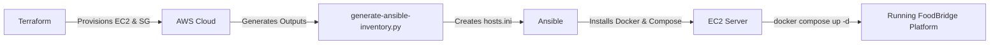

# FoodBridge Deployment Guide

This guide describes how to deploy the **FoodBridge Food Donation Platform** across local, cloud, and automated environments.

---

## 1. Automated AWS Deployment (Terraform + Ansible) - Recommended

For production cloud deployment, use the automated pipeline integrating **Terraform (IaC)** and **Ansible (Configuration Management)**:



### Quick Deployment Steps:

1. **Provision Infrastructure with Terraform**:
   ```bash
   cd infra/terraform
   cp terraform.tfvars.example terraform.tfvars
   # Edit terraform.tfvars with your key_name and allowed_ssh_cidr
   terraform init
   terraform plan
   terraform apply
   ```

2. **Generate Ansible Inventory**:
   From project root:
   ```bash
   python scripts/generate-ansible-inventory.py
   ```

3. **Deploy with Ansible**:
   ```bash
   cd deploy/ansible
   ansible all -m ping
   ansible-playbook playbooks/site.yml
   ```

4. **Detailed Guides**:
   * Complete Terraform details: [TERRAFORM_GUIDE.md](file:///c:/Users/Md%20Sahil/Desktop/Food_donation/docs/TERRAFORM_GUIDE.md)
   * Complete Ansible details: [ANSIBLE_GUIDE.md](file:///c:/Users/Md%20Sahil/Desktop/Food_donation/docs/ANSIBLE_GUIDE.md)
   * DevOps Architecture: [DEVOPS_ARCHITECTURE.md](file:///c:/Users/Md%20Sahil/Desktop/Food_donation/docs/DEVOPS_ARCHITECTURE.md)

---

## 2. Docker Compose (Local Development & Demos)

1. Install [Docker Desktop](https://www.docker.com/products/docker-desktop/) (Windows/macOS) or Docker Engine + Compose (Linux).
2. From `deploy/docker/`, run:

   ```bash
   docker compose up --build -d
   ```

3. Visit `http://localhost:18080` (or the host port set in `FOODBRIDGE_GATEWAY_PORT`).

### Resource Expectations
- **Elasticsearch** is memory hungry; the compose file sets `ES_JAVA_OPTS=-Xms512m -Xmx512m`.
- If ELK is not required, remove `elasticsearch`, `logstash`, and `kibana` services locally (core app still runs).

---

## 3. GitHub Actions CI/CD Pipeline

The GitHub Actions workflow lives in `.github/workflows/`:
* `ci.yml`: Runs Jest test suites across all 4 microservices (`auth`, `donation`, `notification`, `tracking`), builds the React frontend, and verifies Docker container image builds with Docker Buildx.
* `deploy.yml`: Automated CD workflow triggering upon successful CI completion or manual dispatch (`workflow_dispatch`), safely connecting to the EC2 server over SSH to update and verify containers.

---

## 4. Jenkins (Self-Hosted CI Alternative)

Jenkins runs **separately** from the app stack so you can CI without starting Postgres/ELK.

1. From `deploy/jenkins/`:

   ```powershell
   docker compose up --build -d
   ```

2. UI: **http://localhost:8080** (`JENKINS_HTTP_PORT` to change the host port).
3. Create a **Pipeline** job: *Pipeline script from SCM* → Git URL → **Script Path** `deploy/jenkins/Jenkinsfile`.
4. Details, Docker socket permissions, and customization: [jenkins/README.md](../deploy/jenkins/README.md).

---

## 5. Kubernetes (Optional Cluster Manifests)

Sample manifests live under `deploy/kubernetes/`:
1. Build and push images to your container registry.
2. Replace image names in `Deployment` manifests.
3. Create `Secret` objects for `JWT_SECRET`, DB credentials, and `INTERNAL_API_KEY`.
4. Apply manifests: `kubectl apply -f deploy/kubernetes/`.

---

## 6. Backups & Disaster Recovery

- **PostgreSQL**: Schedule `pg_dump` against each logical database (`foodbridge_auth`, `foodbridge_donation`, `foodbridge_notification`, `foodbridge_tracking`):
  ```bash
  docker compose -f deploy/docker/docker-compose.yml exec -T postgres pg_dump -U foodbridge foodbridge_auth > backup_auth.sql
  ```
- **Donation images**: Back up the `donation_uploads` Docker volume.

---

## 7. TLS / HTTPS

Terminate TLS at the Nginx reverse proxy gateway or AWS Application Load Balancer (ALB). Obtain certificates via Let’s Encrypt (`certbot`) or AWS Certificate Manager (ACM), then configure `listen 443 ssl` in Nginx.
