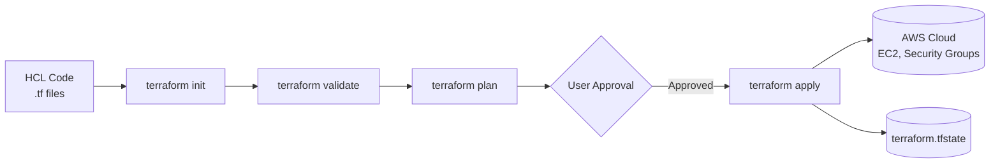

# Terraform Guide - FoodBridge Infrastructure as Code (Unit IV)

This guide provides a comprehensive explanation of Infrastructure as Code (IaC) using Terraform for the **FoodBridge Food Donation Platform**.

---

## 1. What is Terraform and Why Is It Used?

**Terraform** is an open-source Infrastructure as Code (IaC) tool created by HashiCorp. It allows engineers to define cloud and on-premises resources in human-readable configuration files (HCL - HashiCorp Configuration Language) that can be versioned, shared, and reused.

### Why Terraform is Used in FoodBridge:
1. **Declarative State**: We describe the *desired end-state* of our cloud infrastructure (e.g., "one EC2 instance with 30GB gp3 storage, in an isolated security group"), and Terraform determines the steps required to achieve that state.
2. **Reproducibility & Consistency**: Eliminates human error caused by clicking through the AWS Management Console ("ClickOps"). Environments (Production, Staging, Dev) can be recreated with identical specifications.
3. **Auditability & Version Control**: All infrastructure changes are tracked in Git commits, providing full visibility into who changed what and when.
4. **Automated Safety Checks**: `terraform plan` previews all additions, modifications, and deletions before anything touches live cloud resources.

---

## 2. Terraform Architecture & Workflow



### The Core Workflow:
1. **`terraform init`**: Initializes the working directory, downloads the required cloud provider plugins (AWS provider `~> 5.0`), and configures the state backend.
2. **`terraform validate`**: Verifies that configuration files are syntactically valid and internally consistent without contacting AWS.
3. **`terraform plan`**: Compares the desired state in code against the actual infrastructure recorded in the state file and live AWS APIs. It produces an execution plan detailing exactly what will be created (+), modified (~), or destroyed (-).
4. **`terraform apply`**: Executes the approved plan against AWS APIs to reach the desired state.
5. **`terraform destroy`**: Destroys all managed infrastructure (disabled/guarded in production via `prevent_destroy`).

---

## 3. Configuration Breakdown in FoodBridge

The Terraform codebase lives under `infra/terraform/`:

| File | Purpose |
|---|---|
| `versions.tf` | Declares required Terraform version (`>= 1.5.0`) and provider version requirements (`aws ~> 5.0`). |
| `providers.tf` | Configures the AWS provider, region, and default tags for all resources. |
| `variables.tf` | Declares input variables (instance type, SSH CIDR, volume size, region). |
| `main.tf` | Defines data sources (Ubuntu AMI, default VPC), security groups, and the EC2 instance. |
| `outputs.tf` | Exposes critical outputs (public IP, instance ID, SSH command, Ansible inventory entry). |
| `terraform.tfvars.example` | Template for user-specific values (never commit real `terraform.tfvars`). |
| `.gitignore` | Prevents committing `.tfstate`, backups, and secret variables to Git. |

---

## 4. Security & Least Privilege

The security group (`aws_security_group.app_sg`) in `main.tf` enforces strict firewall rules:

| Port | Protocol | Source | Purpose |
|---|---|---|---|
| `22` | TCP | `var.allowed_ssh_cidr` (`YOUR_IP/32`) | Secure remote administration via SSH. |
| `80` | TCP | `0.0.0.0/0` | Public web traffic to Nginx reverse proxy. |
| `443` | TCP | `0.0.0.0/0` | HTTPS secure web traffic. |
| `18080` | TCP | `0.0.0.0/0` | FoodBridge Gateway host port. |
| `3001` | TCP | `var.allowed_monitoring_cidr` | Grafana dashboard (restricted). |
| `9090` | TCP | `var.allowed_monitoring_cidr` | Prometheus metrics (restricted). |
| **5432** | TCP | **BLOCKED** | PostgreSQL database (accessible ONLY inside Docker network). |
| **9200** | TCP | **BLOCKED** | Elasticsearch (internal search only). |
| **4001-4004**| TCP | **BLOCKED** | Microservices (accessible ONLY via Nginx gateway). |

---

## 5. Step-by-Step Execution Guide

### Step 1: Configure AWS CLI Credentials
Ensure your AWS profile is active:
```powershell
aws configure --profile foodbridge
$env:AWS_PROFILE = "foodbridge"
aws sts get-caller-identity
```

### Step 2: Prepare Variable File
Navigate to the Terraform directory and copy the template:
```powershell
cd infra/terraform
cp terraform.tfvars.example terraform.tfvars
```
Edit `terraform.tfvars` with:
* Your AWS Key Pair name (e.g., `key_name = "foodbridge-key"`).
* Your public IP address with `/32` (e.g., `allowed_ssh_cidr = ["203.0.113.15/32"]`).

### Step 3: Initialize Terraform
```bash
terraform init
```

### Step 4: Validate Configuration & Format Check
```bash
terraform fmt -check
terraform validate
```

### Step 5: Review the Execution Plan
```bash
terraform plan
```
Carefully review the proposed changes.

### Step 6: Apply Infrastructure (Only After Approval)
```bash
terraform apply
```
Type `yes` when prompted.

### Step 7: View Outputs
```bash
terraform output
terraform output -json
```

---

## 6. How to Import Existing AWS Resources

If your EC2 instance is already running on AWS and you want Terraform to manage it without recreating it:

### Step 1: Identify Resource IDs
* EC2 Instance ID: e.g., `i-0abcdef1234567890`
* Security Group ID: e.g., `sg-0123456789abcdef0`

### Step 2: Run Terraform Import Commands
```bash
# 1. Import Security Group
terraform import aws_security_group.app_sg sg-0123456789abcdef0

# 2. Import EC2 Instance
terraform import aws_instance.app_server i-0abcdef1234567890
```

### Step 3: Run Plan to Verify Zero Changes
```bash
terraform plan
```
If Terraform shows planned changes, adjust `variables.tf` or `main.tf` to match the existing server's properties (such as `instance_type` or `root_block_device`) until `terraform plan` outputs:
```text
No changes. Your infrastructure matches the configuration.
```

---

## 7. Remote State & S3 Backend Migration

By default, Terraform stores state locally in `terraform.tfstate`. For production teams, migrate to an S3 backend with DynamoDB state locking to prevent concurrent apply race conditions.

### Bootstrap S3 Bucket and DynamoDB Table
Run using AWS CLI:
```bash
# Create encrypted S3 Bucket
aws s3api create-bucket \
  --bucket foodbridge-terraform-state-prod \
  --region ap-south-1 \
  --create-bucket-configuration LocationConstraint=ap-south-1

aws s3api put-bucket-encryption \
  --bucket foodbridge-terraform-state-prod \
  --server-side-encryption-configuration '{"Rules": [{"ApplyServerSideEncryptionByDefault": {"SSEAlgorithm": "AES256"}}]}'

aws s3api put-bucket-versioning \
  --bucket foodbridge-terraform-state-prod \
  --versioning-configuration Status=Enabled

# Create DynamoDB Table for State Locking
aws dynamodb create-table \
  --table-name foodbridge-terraform-locks \
  --attribute-definitions AttributeName=LockID,AttributeType=S \
  --key-schema AttributeName=LockID,KeyType=HASH \
  --billing-mode PAY_PER_REQUEST \
  --region ap-south-1
```

### Enable Backend in `versions.tf`
Uncomment the `backend "s3"` block in `infra/terraform/versions.tf` and run:
```bash
terraform init -migrate-state
```
Terraform will automatically copy your local state file into the encrypted S3 bucket.
