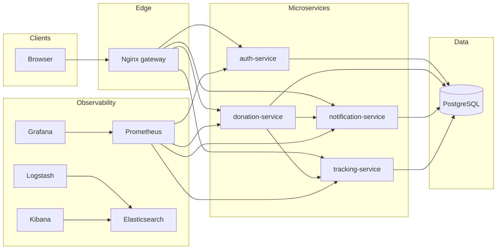
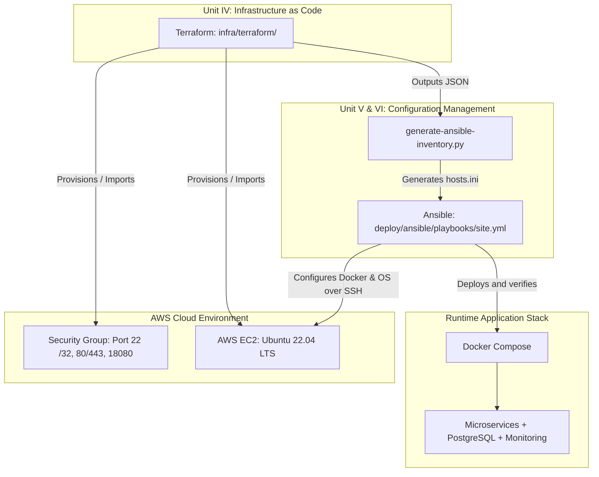

# FoodBridge Architecture

## 1. Logical View

## 2. Infrastructure & DevOps Automation Layer

## 3. Service Boundaries

- **Authentication (`auth-service`)**: Owns users, password hashes (bcrypt), JWT issuance, and admin user listing.
- **Donations (`donation-service`)**: Owns listings, pickup lifecycle (`open` → `accepted` → `completed` / `expired`), and file storage for photos.
- **Notifications (`notification-service`)**: Owns per-user notification rows; internal HTTP is used from donation flows.
- **Tracking (`tracking-service`)**: Owns pickup sessions and geo points; internal HTTP creates a session when an NGO accepts a donation.

## 4. Networking (Docker)

All containers attach to the **bridge** network `foodbridge`. Services resolve each other by **DNS name** (Compose service names). Only **Nginx** and observability UIs expose host ports by default.

## 5. Security Perimeter

- Internal microservice ports (`4001`, `4002`, `4003`, `4004`), PostgreSQL (`5432`), and Elasticsearch (`9200`) are **not** exposed to the host or internet.
- Public traffic routes exclusively through the **Nginx reverse proxy gateway** on port `18080` (or `80`/`443`).
- SSH administration on port `22` and monitoring dashboards on ports `3001`/`9090` are restricted strictly to trusted administrator IPs (`/32`).
